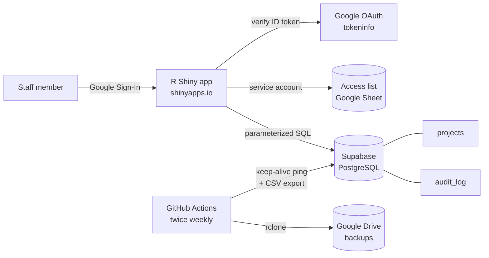

# Project Pipeline Tracker: R Shiny + Supabase + Google Cloud (Case Study)

A secure, role-based web app I designed and built for a research center to track its pipeline of grant-funded projects, from proposal to active award. It combines an **R Shiny** front end, a **Supabase PostgreSQL** database, **Google Cloud** sign-in and service accounts, and **GitHub Actions** for automated backups.

> **About this repo:** the production app is an internal tool, so its source code and data stay private. This case study describes the problem, the architecture and my design decisions. The code in [`snippets/`](snippets/) is **simplified and rewritten** to show the key techniques; it contains no real data, credentials or organization-specific details.

| Item | Details |
|---|---|
| **Role** | Sole developer: requirements, database design, app, authentication, deployment, automation |
| **Stack** | R · Shiny · bslib · DT · Plotly · PostgreSQL (Supabase) · Google Identity Services · Google Sheets API · GitHub Actions · rclone |
| **Users** | Research staff with three access levels: Admin, Editor, Contributor |
| **Year** | 2025 |

## The Problem

The center needed a single place to track every project in its pipeline (status, funder, lead investigators, budget, probability of award) that:
- staff could **update directly**, without emailing spreadsheets around,
- shows **each person only what they should see**,
- keeps a **full history of who changed what**, and
- is **backed up automatically**, without anyone remembering to do it.

## Architecture



1. **Sign-in:** users sign in with Google. The app verifies the ID token **on the server** and looks up the user's email in a private access-list Google Sheet, read through a **service account**.
2. **Authorization:** the sheet maps each email to a role. The role decides which tabs appear and which rows are visible.
3. **Data:** all reads and writes go to Supabase PostgreSQL using **parameterized queries**. Every edit also writes an **audit-log** row.
4. **Backups:** a scheduled GitHub Actions workflow keeps the free-tier database active, exports the tables to CSV, and uploads them to Google Drive.

## Features

| Tab | Who sees it | What it does |
|---|---|---|
| View Table | All roles | Searchable, filterable project table with Excel export |
| Edit Table | All roles | Inline editing (dropdowns, sliders, text, notes); each change is logged |
| Add Project | All roles | Form that inserts a new project (logged to the audit table) |
| Links | All roles | Quick links to related team resources |
| Graphs | Admin | Budget by funder, pipeline by status and lead, interactive Plotly charts |
| SQL Query | Admin | Ad-hoc SQL console for reporting and audits |

**Row-level access:** Contributors only see projects where they're listed as a lead or co-lead. Editors and Admins see everything.

## Key Design Decisions

### 1. Verify Google sign-in on the server, and keep the access list outside the code
The browser only gets a Google ID token; the server checks it against Google (correct app, verified email) before trusting it. Roles live in a Google Sheet that admins already know how to edit, read by a service account. Adding a user doesn't need a code change or redeploy.
→ [`snippets/01_google_sign_in.R`](snippets/01_google_sign_in.R)

### 2. Enforce row-level access in one place
A single filtering function sits between the database and every table view, so a Contributor can't see other people's projects through any tab.
→ [`snippets/02_row_level_access.R`](snippets/02_row_level_access.R)

### 3. Every edit is parameterized and audited
Inline edits update one field and record the old value, the new value, who changed it and when. Values are always passed as query parameters, never pasted into SQL.
→ [`snippets/03_audited_update.R`](snippets/03_audited_update.R) · schema: [`snippets/schema.sql`](snippets/schema.sql)

### 4. No secrets in code
Database credentials, the OAuth client ID and the service-account key all come from environment variables or GitHub Secrets. Nothing sensitive is committed.
→ [`snippets/04_db_connection.R`](snippets/04_db_connection.R)

### 5. Backups that run themselves
A GitHub Actions workflow runs twice a week:
1. Pings the database so the Supabase free tier doesn't pause it.
2. Exports each table to a timestamped CSV folder.
3. Uploads the folder to Google Drive with rclone.

It replaced an earlier email-based backup.
→ [`snippets/05_backup_workflow.yml`](snippets/05_backup_workflow.yml) · [`snippets/06_export_tables.R`](snippets/06_export_tables.R)

## Repository Contents

```
├── README.md
└── snippets/
    ├── 01_google_sign_in.R        # Server-side token verification + role lookup
    ├── 02_row_level_access.R      # Contributor row filtering
    ├── 03_audited_update.R        # Allowlisted, parameterized update + audit log
    ├── 04_db_connection.R         # Credentials from environment variables
    ├── 05_backup_workflow.yml     # Scheduled GitHub Actions backup
    ├── 06_export_tables.R         # Table export used by the workflow
    └── schema.sql                 # Simplified database schema
```
